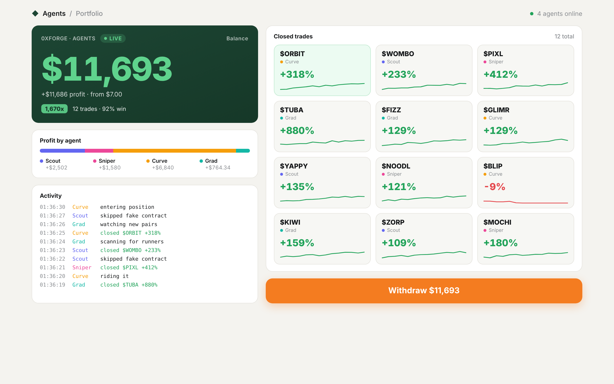

# 0xForge

Live portfolio dashboard for a team of four trading agents.



## Agents

| Agent | Role |
|---|---|
| **Scout** | watches new pairs and flags early runners |
| **Sniper** | fast entries on fresh launches |
| **Curve** | trades along the bonding curve |
| **Grad** | holds tokens through graduation |

## Features

- Live balance with growth multiplier and win rate
- Profit split by agent
- Real-time activity log
- Grid of closed trades with sparklines
- Notifications on every closed trade
- Light, responsive layout, no dependencies

## Run

No build step. Open `index.html` in a browser, or serve the folder:

```bash
npx serve .
```

Or turn on **GitHub Pages** for the `main` branch in the repository settings.

## Configuration

The trade feed, starting balance, position size and speed live in `src/data.js`. Edit that file to change what the dashboard plays back.

```
index.html
src/
  styles.css   # layout and theme
  data.js      # trade feed and settings
  app.js       # rendering and animation
```

## License

Apache-2.0
